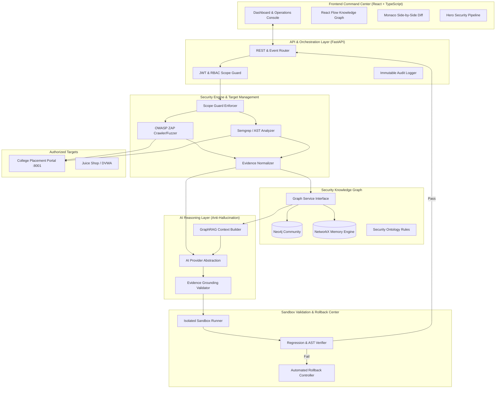

# AegisOne AI — System Architecture & Technical Specification

## 1. High-Level Architecture Overview



---

## 2. The Core Security Decision Workflow

```mermaid
sequenceDiagram
    autonumber
    actor Dev as Developer / AppSec Lead
    participant Scope as Scope Guard
    participant Scanner as Security Engine (ZAP/Semgrep)
    participant Graph as Knowledge Graph
    participant Risk as Contextual Risk Engine
    participant AI as AI Analyst (Evidence-Grounded)
    participant Box as Isolated Sandbox
    participant Rollback as Rollback Controller

    Dev->>Scope: Launch Security Scan on Target
    Scope->>Scope: Verify Target in Whitelist (localhost/authorized)
    Scope->>Scanner: Execute AST and DAST Scans
    Scanner-->>Graph: Raw Findings & Evidence (CWE, URI, Payload)
    Graph->>Graph: Traverse Ontology (CWE ↔ OWASP ↔ Asset ↔ Attack Path)
    Graph->>Risk: Compute Contextual Risk Score (0-100)
    Risk-->>Dev: Prioritized Findings with Mathematical Breakdown
    Dev->>AI: Request Remediation Analysis
    AI->>AI: Format Confirmed Evidence vs Interpretation vs Recommendation
    AI-->>Dev: Proposed Secure Code Patch
    Dev->>Box: Dispatch Patch to Isolated Sandbox
    Box->>Box: Apply Patch to Baseline
    Box->>Box: Execute Functional Regression Tests
    Box->>Box: Execute Secondary Static & Security Scans
    alt Validation Passed (Zero Regressions, Flaw Eliminated)
        Box-->>Dev: Remediated & Validated (Ready to Merge)
    else Validation Failed (Broken Features or New Vulnerability Introduced)
        Box->>Rollback: Trigger Automated Rollback
        Rollback->>Box: Restore Baseline Code
        Rollback-->>Dev: REMEDIATION REJECTED: Security Validation Failed
    end
```

---

## 3. Knowledge Graph Ontology

The Knowledge Graph treats security knowledge not as flat text, but as an interconnected ontology:

- **`Vulnerability`**: Specific instance detected by scanners.
- **`CWE`**: Common Weakness Enumeration definition.
- **`OWASP_Category`**: OWASP Top 10 mapping.
- **`Attack_Technique`**: MITRE ATT&CK technique reference.
- **`Asset`**: Application component (Database, Auth Service, REST API).
- **`Data_Sensitivity`**: High (PII, Credentials), Medium, Low.
- **`Mitigation`**: Verified defense strategy (Parameterized queries, CSP, Encoding).
- **`Security_Control`**: NIST SP 800-53 / ISO 27001 control.

---

## 4. Context-Aware Risk Engine Formula

Rather than relying purely on CVSS base scores, AegisOne computes contextual risk as:

$$\text{Risk Score} = \min\left(100, \, \left( S_{\text{tech}} \times 4.0 + E_{\text{xploit}} \times 2.0 + C_{\text{asset}} \times 2.5 + D_{\text{sens}} \times 1.5 + X_{\text{pos}} \times 1.0 \right) \times C_{\text{onfidence}} \right)$$

Where:
- $S_{\text{tech}} \in [0, 10]$: Technical Severity (CVSS equivalent)
- $E_{\text{xploit}} \in [0, 1]$: Exploitability factor (PoC availability, attack complexity)
- $C_{\text{asset}} \in [0, 1]$: Asset Criticality (Core DB = 1.0, Static Asset = 0.2)
- $D_{\text{sens}} \in [0, 1]$: Data Sensitivity (PII/Student Records = 1.0)
- $X_{\text{pos}} \in [0, 1]$: Network Exposure (External/Public = 1.0, Internal = 0.4)
- $C_{\text{onfidence}} \in [0.5, 1.0]$: Evidence Verification Confidence
