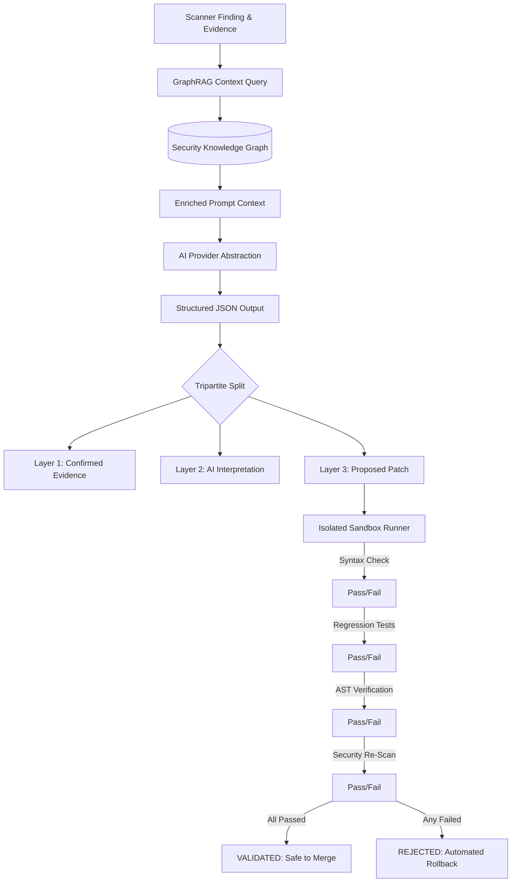

# AegisOne AI — AI Architecture & Anti-Hallucination Design

## 1. The Core AI Challenge in Cybersecurity
Large Language Models (LLMs) trained on public code repositories often generate remediations that:
1. Appear superficially correct while failing syntax compilation.
2. Break downstream functional dependencies (functional regression).
3. Introduce subtle secondary vulnerabilities (e.g. replacing SQL injection with unauthenticated object access or memory leaks).

AegisOne AI solves this by treating the AI strictly as an **untrusted advisory layer**. AI outputs are never executed directly on host systems and must survive empirical validation in the Sandbox.

## 2. The Tripartite Output Model
To prevent user confusion and eliminate hallucinations, every analysis presented in AegisOne is strictly partitioned into three independent visual layers:

### Layer 1: Confirmed Evidence
Contains ONLY raw factual data captured directly by security tools (e.g. OWASP ZAP payload, HTTP request/response headers, AST line numbers, confidence score). The AI is not permitted to modify this layer.

### Layer 2: AI Interpretation
Contextual threat reasoning generated by the model, grounded directly in the 2-hop neighborhood retrieved from the Security Knowledge Graph (connecting CWE to OWASP, MITRE ATT&CK techniques, and affected assets).

### Layer 3: Actionable Recommendation & Patch
A proposed code patch formatted as a standard unified diff, along with explicit instructions for sandbox testing and regression verification.

## 3. Anti-Hallucination Guardrail Rules
- **Rule 1 (Evidence Citation)**: The AI model must cite exact CWE IDs and evidence parameters.
- **Rule 2 (Refusal on Ambiguity)**: If scanner evidence does not establish proof-of-concept exploitability, the model returns: *"Insufficient evidence to confidently determine this."*
- **Rule 3 (Zero Command Execution)**: Raw LLM text is never piped to `bash`, `powershell`, or `sh`.
