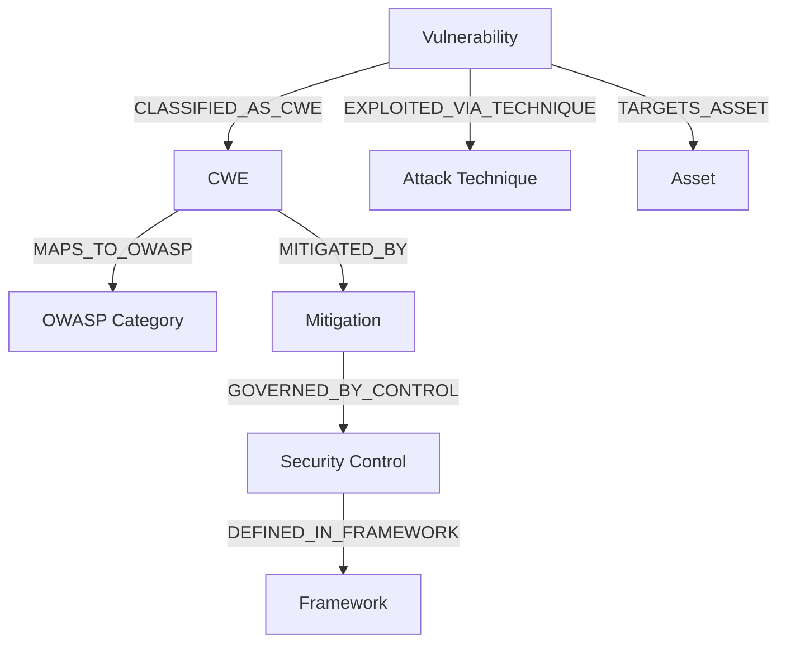

# AegisOne AI — Security Knowledge Graph Architecture

## 1. Ontology Design & Node Categories
The Security Knowledge Graph models application security knowledge not as disparate text, but as an interconnected ontology:

### Node Category Definitions:
1. **`Vulnerability`**: Live instance discovered during security scanning (e.g. `VULN-SQLI`, `VULN-XSS`).
2. **`CWE`**: MITRE Common Weakness Enumeration standard (e.g. `CWE-89`, `CWE-79`, `CWE-798`).
3. **`OWASP_Category`**: OWASP Top 10 classifications (e.g. `A03:2021-Injection`).
4. **`Attack_Technique`**: MITRE ATT&CK Enterprise tactics and techniques (e.g. `T1190: Exploit Public-Facing Application`).
5. **`Asset`**: Application subsystems and data stores with associated data sensitivity ratings (`HIGH_PII`, `CREDENTIALS`).
6. **`Mitigation`**: Proven architectural countermeasures (e.g. `Parameterized Queries`, `Bleach HTML Sanitization`).
7. **`Security_Control`**: NIST SP 800-53 Rev. 5 controls (e.g. `SI-10: Information Input Validation`).
8. **`Framework`**: Compliance and standard catalogs (`NIST SP 800-53`, `OWASP ASVS`).

## 2. Dual-Mode Architecture: NetworkX & Neo4j
- **Zero-Dependency In-Memory NetworkX Engine**: Provides instant graph traversals, shortest-path calculation, and neighborhood extractions with <5ms latency. Works natively out-of-the-box on any development machine.
- **Neo4j Community Edition Engine**: Integrated via Bolt driver (`bolt://localhost:7687`), enabling Cypher graph queries when Docker Compose environment is started.
