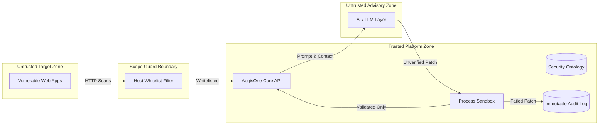

# AegisOne AI — Threat Model & Self-Defense Architecture
### Frameworks: Microsoft STRIDE & DREAD Risk Assessment

## 1. Threat Boundary & Trust Zones
AegisOne AI operates across three distinct trust zones:
1. **Untrusted Target Zone**: Web applications being scanned (e.g. vulnerable College Placement Portal).
2. **Untrusted AI Layer**: Generative LLM APIs whose outputs can contain subtle hallucinations, incomplete sanitization, or secondary vulnerabilities.
3. **Trusted Core Orchestrator**: The FastAPI backend, isolated sandbox process runner, Knowledge Graph ontology, and immutable audit database.

## 2. STRIDE Assessment Matrix

| Threat Category | Potential Attack Vector | Defensive Control Implemented in AegisOne |
| :--- | :--- | :--- |
| **Spoofing** | Adversary attempts to forge scan results or impersonate authorized security engineer. | PBKDF2-HMAC-SHA256 password hashing, HS256 JWT tokens with 8-hour expiry, and strict user session validation. |
| **Tampering** | Malicious patch injection into production branch via hallucinated AI fix. | **Sandbox Isolation**: AI-generated code is NEVER applied directly to production. Multi-stage testing requires 100% regression pass + secondary security re-scan. |
| **Repudiation** | Operator denies launching scan or approving unsafe code patch. | **Immutable Audit Log**: Every scan, AI suggestion, sandbox run, and rollback is permanently recorded with timestamp and actor ID. |
| **Information Disclosure** | Vulnerability payloads or student PII leaking through AI model prompts. | **Scope Guard**: Blocks external telemetry. Evidence is scrubbed of credentials before passing to LLM context. |
| **Denial of Service** | Unrestricted scanning consuming network bandwidth or crashing target systems. | Scans restricted to localhost/127.0.0.1; rate-limited crawler concurrency; Scope Guard blocks arbitrary IPs. |
| **Elevation of Privilege** | Attacker leverages scanner subprocess to execute shellcode on host. | Zero direct shell command execution from LLM responses. Static analysis and test runners executed in strictly controlled subprocess environments. |
